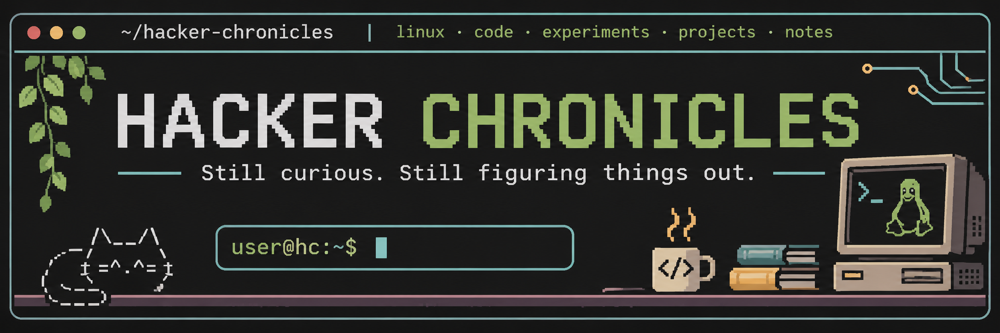

# 🖥️ Hacker Chronicles

*Linux, code, experiments, and the occasional questionable decision.*

Welcome to **Hacker Chronicles**, my little corner of the internet!

This is my personal website, a place to share my adventures with Linux, programming, computers, and whatever else catches my curiosity.

It's not a professional project or some revolutionary piece of software. It's simply a playground where I can experiment, learn new things, break a few things (hopefully not too many), and have some fun along the way.

## 🌍 Come visit!

**[🚀 Visit Hacker Chronicles](https://takeshi-pt.github.io/hacker-chronicles/)**

**[🤖 Meet Takeshi: The Lazy Dev](https://takeshi-pt.github.io/hacker-chronicles/lazydev/)**

Yes, there's an entire fictional company run by a questionable robot. Don't ask. Just visit. 😹

## 🔧 What's inside?

- **Hacker Chronicles** — My personal website, stories, computer setup, and experiments.
- **Takeshi: The Lazy Dev** — A separate little cyberpunk comedy universe, where corporate nonsense meets robot-powered laziness.
- **Journal** — Thoughts, discoveries, and stories. Coming soon!
- **Projects** — My experiments and creations. Also coming soon!

The Lazy Dev company, its staff, and its questionable business achievements are fictional satire. The programming experiments behind the scenes are real and AI-assisted.

## 💻 The source code

You're looking at it!

This repository contains the source code for my experimental website. Nothing particularly fancy: mostly HTML, CSS, JavaScript, and a healthy dose of curiosity.

Feel free to explore, see how things work, and learn from my experiments. I'm happy if something here gives you an idea for your own projects.

Just remember: this is a hobby playground, not a polished software product. Things may change, disappear, or occasionally explode. (Hopefully only metaphorically.)

### Want to run it locally?

You don't need complicated tools or a build system.

From the project directory, run:

```bash
python3 -m http.server 8000
```

Then open **http://localhost:8000/** in your browser.

Press `Ctrl+C` to stop the server.

That's it! No frameworks, no complicated installation. Just a static website doing its thing.

## 🚧 Always under construction

Hacker Chronicles is an ongoing experiment. Some sections are unfinished, others will grow over time, and new ideas might appear without warning.

There's also **Afterfall**, a game experiment still being developed and reviewed. No public downloads yet.

No deadlines, no corporate roadmaps, no promises of world domination.

Well... maybe Takeshi has other plans.

---

*Built with curiosity, plenty of experimentation, and a little help from AI.*

**Thanks for visiting!** 🐱
