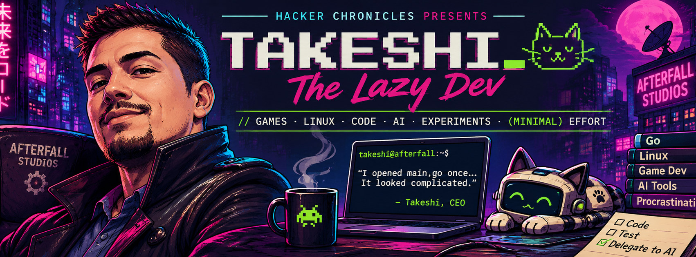

# 🤖 Takeshi: The Lazy Dev

**ZERO COMMITS. INFINITE CONFIDENCE.**

*Welcome to Afterfall Studios — where the CEO takes all the credit, the AI does all the work, and somehow software gets made.*



## 🚀 Visit our glorious empire!

**[🌐 Enter Takeshi: The Lazy Dev](https://takeshi-pt.github.io/hacker-chronicles/lazydev/)**

We recommend visiting the actual website. Management spent considerable resources ensuring the buttons look impressive.

## 🏢 About this highly questionable company

Afterfall Studios is a completely fictional software empire led by **Takeshi**, a visionary CEO whose greatest achievement is convincing an AI to do his programming.

Our business philosophy is simple:

> "Why write code when you can delegate it and take the credit?"
>
> — Takeshi, CEO / CTO / Founder / Employee of the Month

Our staff is exhausted, our deadlines are imaginary, and our profits have never survived an independent audit.

But at least the website looks cool.

## 📰 What happens around here?

- **Breaking News** — Corporate scandals, suspicious financial reports, and executive incompetence.
- **The Saga** — The legendary story of how this questionable empire came into existence.
- **Software** — Actual programming experiments hiding behind all the nonsense.
- **Comics** — The adventures of Takeshi and his eternally overworked AI engineer.
- **The Studio** — Meet the staff responsible for absolutely everything management claims to have accomplished.

All available through our [official corporate headquarters](https://takeshi-pt.github.io/hacker-chronicles/lazydev/).

## 🎮 Wait... some of this is real?

Surprisingly, yes!

**Takeshi: Afterfall** is a real experimental text-based RPG written in Go.

A post-apocalyptic world without humans, populated by robots, drones, and AI systems. Our robot engineer explores the ruins, collects scrap, upgrades hardware, and encounters software that may or may not improve its chances of survival.

It's a hobby programming project, developed with AI assistance while learning Go.

The game is still being reviewed and tested. Public source downloads aren't available yet.

The fictional company is ridiculous. The programming experiments are real.

Management insists this distinction is legally important.

## 💻 The technology behind the nonsense

This website is built with good old-fashioned:

**HTML + CSS + JavaScript**

No complicated frameworks, build systems, or mysterious dependencies.

The Lazy Dev website has its own cyberpunk styling, separate from the main Hacker Chronicles site.

Feel free to explore the source, learn from the experiments, and discover how the whole thing works.

Be warned: some of the code may have been written while the CEO was taking a nap.

### 🛠️ Want to run it locally?

Clone or download the Hacker Chronicles repository.

From the repository's main directory, run:

```bash
python3 -m http.server 8000
```

Then open:

**http://localhost:8000/lazydev/**

That's it! Your very own local corporate empire.

Press `Ctrl+C` to stop the server.

## ⚠️ A small corporate disclaimer

Afterfall Studios, its employees, financial achievements, news reports, and executive accomplishments are **fictional satire**.

The website is a creative hobby project, made for fun, experimentation, and learning.

The real programming projects are clearly distinguished from the fictional stories. AI assistance is part of both the development process and the joke.

No shareholders were harmed in the making of this website.

Probably.

---

### 🐱 A message from management

*This README was prepared by the AI engineering department.*

*The CEO reviewed none of the technical details but has enthusiastically approved the general direction.*

**Made with curiosity, questionable management decisions, and an unreasonable amount of confidence.**

**© Afterfall Studios — Fictional profits. Real experiments.**
